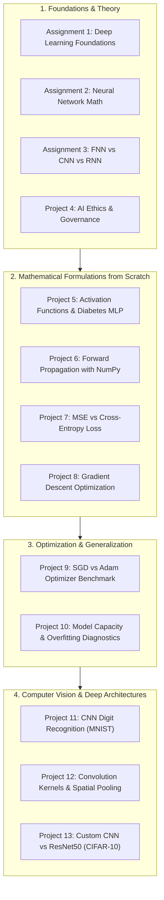

# Deep Learning: Architectures, Foundations & Laboratory Implementations

[](https://www.python.org/)
[](https://www.tensorflow.org/)
[](https://keras.io/)
[](https://numpy.org/)
[](https://opencv.org/)
[](https://scikit-learn.org/)
[](LICENSE)

A structured, progressive collection of Deep Learning implementations, neural network mathematical formulations, and weekly laboratory projects. This repository covers topics ranging from foundational feedforward mechanics and gradient descent coded from scratch in NumPy, to advanced computer vision models, convolutional feature extraction, regularization analysis, and transfer learning with ResNet50 on standard benchmarks (MNIST, CIFAR-10, Iris, and Pima Diabetes).

---

## Table of Contents

- [Overview](#overview)
- [Curriculum & Project Taxonomy](#curriculum--project-taxonomy)
- [Weekly Tasks & Laboratory Directory](#weekly-tasks--laboratory-directory)
- [Key Experimental Results & Benchmarks](#key-experimental-results--benchmarks)
- [Detailed Module Breakdown](#detailed-module-breakdown)
  - [Module 1: Foundations & Architecture Taxonomy](#module-1-foundations--architecture-taxonomy)
  - [Module 2: Mathematical Formulations & NumPy from Scratch](#module-2-mathematical-formulations--numpy-from-scratch)
  - [Module 3: Optimization, Regularization & Generalization](#module-3-optimization-regularization--generalization)
  - [Module 4: Computer Vision & Transfer Learning](#module-4-computer-vision--transfer-learning)
- [Tech Stack & Tools](#tech-stack--tools)
- [Installation & Environment Setup](#installation--environment-setup)
- [Running the Notebooks](#running-the-notebooks)
- [Repository Structure](#repository-structure)
- [Author & License](#author--license)

---

## Overview

Deep learning powers modern artificial intelligence, but mastering it requires understanding both the mathematical underpinnings (matrix calculus, backpropagation, optimization dynamics) and the practical engineering of deep models.

This repository serves as a comprehensive laboratory notebook and code repository documenting:
1. **Mathematical derivations and scratch implementations**: Forward propagation, custom loss functions (MSE vs. Cross-Entropy), and gradient descent parameter updates without high-level abstractions.
2. **Comparative optimization studies**: First-order optimization behavior (SGD vs. Adam) and empirical analysis of learning rate dynamics.
3. **Generalization diagnostics**: Systematic evaluation of underfitting, balanced capacity, and overfitting via learning curves and train-validation gap tracking.
4. **Computer vision architectures**: Handcrafted spatial convolution and pooling with OpenCV, custom CNN architectures, and transfer learning using deep residual networks (ResNet50).

---

## Curriculum & Project Taxonomy



---

## Weekly Tasks & Laboratory Directory

| Task / Module | Topic / Focus | Key Concepts & Methodologies | Dataset / Input | Primary Tools |
| :--- | :--- | :--- | :--- | :--- |
| **[Assignment 1](./Weekly%20Task/Assignment%201/)** | Deep Learning Overview | AI evolution, perceptrons, deep representation hierarchy | Slides / Artifacts | Presentation |
| **[Assignment 2](./Weekly%20Task/Assignment%202/)** | Neural Network Design | Dense connections, weight initialization, vector notation | Mathematical Report | PDF Document |
| **[Assignment 3](./Weekly%20Task/Assignment%203/)** | Architectural Comparative Analysis | Structural tradeoffs between FNN, CNN, and RNN | Comparative Study | PDF Document |
| **[Project 4](./Weekly%20Task/Project%204/)** | AI Ethics & Accountability | Algorithmic bias, data privacy, XAI, and governance | Ethics Framework | PDF Report |
| **[Project 5](./Weekly%20Task/Project%205/)** | Activation Functions | Sigmoid, Tanh, ReLU, Leaky ReLU analysis & MLP training | Pima Diabetes (768 records) | Python, NumPy, Pandas |
| **[Project 6](./Weekly%20Task/Project%206/)** | Forward Propagation from Scratch | Matrix transformations, ReLU hidden activation, Softmax output | Fisher's Iris Dataset | NumPy, Matplotlib |
| **[Project 7](./Weekly%20Task/Project%207/)** | Loss Function Implementation | Exact mathematical formulation of MSE vs. Categorical Cross-Entropy | Synthetic / Probability distributions | NumPy, Python |
| **[Project 8](./Weekly%20Task/Project%208/)** | Gradient Descent from Scratch | Iterative weight/bias update rules, convergence tracking | Linear Regression Dataset | NumPy, Matplotlib |
| **[Project 9](./Weekly%20Task/project%209/)** | Optimizer Comparison | Empirical convergence benchmark comparing SGD vs. Adam | Fisher's Iris Dataset | TensorFlow, Keras, Scikit-Learn |
| **[Project 10](./Weekly%20Task/Project%2010/)** | Capacity & Overfitting Analysis | Simple vs. Moderate vs. Complex architectures, train/val divergence | Fisher's Iris Dataset | TensorFlow, Keras, Scikit-Learn |
| **[Project 11](./Weekly%20Task/Project%2011/)** | CNN Digit Classification | Conv2D, MaxPooling2D, Dropout, Dense, Confusion Matrix | MNIST (70,000 images) | TensorFlow, Keras |
| **[Project 12](./Weekly%20Task/Project%2012/)** | Spatial Convolution & Pooling | Spatial 2D kernels (Sobel, blur, sharpen), Max vs. Average pooling | Natural Images | OpenCV, NumPy, Matplotlib |
| **[Project 13](./Weekly%20Task/Project%2013/)** | Custom CNN vs. ResNet50 | From-scratch CNN vs. Pretrained ResNet50 Transfer Learning | CIFAR-10 (60,000 images) | TensorFlow, Keras, ResNet50 |

---

## Key Experimental Results & Benchmarks

All metrics reported below reflect actual recorded test results and evaluations executed within the laboratory notebooks:

### 1. Computer Vision Benchmarks

| Task | Architecture | Dataset | Trainable Params | Training Time | Test Accuracy | Test Loss |
| :--- | :--- | :--- | :--- | :--- | :--- | :--- |
| **Digit Recognition (P11)** | Custom 2-Stage CNN | MNIST (28x28 grayscale) | 125,898 | ~35s (10 epochs) | **99.20%** | **0.0239** |
| **Object Classification (P13)** | Custom Baseline CNN | CIFAR-10 (32x32 RGB) | 356,810 | 2.74 min (10 epochs) | **39.00%** | 1.9542 |
| **Object Classification (P13)** | ResNet50 (Transfer Learning) | CIFAR-10 (upscaled 96x96) | 263,562 (23.85M total) | 29.74 min (5 epochs) | **47.60%** | 1.5413 |

### 2. Optimization & Model Capacity Benchmarks

| Experiment | Configuration / Model | Epochs / Iterations | Test Accuracy | Test Loss | Key Observation |
| :--- | :--- | :--- | :--- | :--- | :--- |
| **Optimizer Benchmark (P9)** | SGD ($\eta = 0.01$) | 50 epochs | **80.00%** | 0.4278 | Slower convergence; lower recall on difficult classes |
| **Optimizer Benchmark (P9)** | Adam ($\eta = 0.001$) | 50 epochs | **86.67%** | **0.3270** | Faster convergence; superior loss minimization |
| **Capacity Analysis (P10)** | Simple Model (1 hidden layer, 4 units) | 50 epochs | 66.67% (Train: 68.33%) | 0.8124 | Underfitting: insufficient capacity to capture class boundaries |
| **Capacity Analysis (P10)** | Moderate Model (2 hidden layers, 8 & 4 units) | 50 epochs | **96.67%** (Train: 100.0%) | **0.1845** | **Optimal**: high test generalization with 3.33% accuracy gap |
| **Capacity Analysis (P10)** | Complex Model (3 hidden layers, 32, 16, 8 units) | 50 epochs | 93.33% (Train: 100.0%) | 0.2451 | Overfitting: wider train-test loss divergence (6.67% gap) |
| **Gradient Descent (P8)** | Linear Optimization ($w, b$) | 100 iterations | N/A ($R^2 \approx 0.98$) | **0.0159** | Converged to $w \approx 2.0818$, $b \approx 0.7048$ |

---

## Detailed Module Breakdown

### Module 1: Foundations & Architecture Taxonomy
- **Assignment 1 ([Presentation](./Weekly%20Task/Assignment%201/))**: Traces the transition from handcrafted feature engineering to hierarchical representation learning.
- **Assignment 2 ([Neural Network Paper](./Weekly%20Task/Assignment%202/))**: Details perceptron mathematical formulations, activation landscapes, and feedforward matrix operations.
- **Assignment 3 ([Comparative Analysis](./Weekly%20Task/Assignment%203/))**: Evaluates architectural trade-offs:
  - *Feedforward Neural Networks (FNN)*: Structured tabular data; lacks spatial and temporal inductive biases.
  - *Convolutional Neural Networks (CNN)*: Spatial invariance, parameter sharing, and receptive field expansion for visual data.
  - *Recurrent Neural Networks (RNN)*: Hidden state recurrence for sequential modeling and temporal context preservation.
- **Project 4 ([AI Ethics Report](./Weekly%20Task/Project%204/))**: Explores societal impacts of automated systems, bias mitigation techniques, algorithmic transparency, and ethical AI deployment.

### Module 2: Mathematical Formulations & NumPy from Scratch
- **Project 5 ([Activation Functions](./Weekly%20Task/Project%205/))**: Investigates mathematical properties, non-linear transformation curves, derivatives, and performance of Sigmoid, Tanh, ReLU, and Leaky ReLU on the Pima Indians Diabetes dataset.
- **Project 6 ([Forward Propagation](./Weekly%20Task/Project%206/))**: Implements forward inference entirely with NumPy:
  $$\mathbf{Z}^{[1]} = \mathbf{X}\mathbf{W}^{[1]} + \mathbf{b}^{[1]}, \quad \mathbf{A}^{[1]} = \text{ReLU}(\mathbf{Z}^{[1]})$$
  $$\mathbf{Z}^{[2]} = \mathbf{A}^{[1]}\mathbf{W}^{[2]} + \mathbf{b}^{[2]}, \quad \hat{\mathbf{Y}} = \text{Softmax}(\mathbf{Z}^{[2]})$$
- **Project 7 ([Loss Functions](./Weekly%20Task/Project%207/))**: Compares quadratic penalty vs. log-likelihood penalties:
  $$\text{MSE} = \frac{1}{N}\sum_{i=1}^{N}(y_i - \hat{y}_i)^2 \quad \text{vs.} \quad \mathcal{L}_{\text{CE}} = -\frac{1}{N}\sum_{i=1}^{N}\sum_{c=1}^{C} y_{i,c} \log(\hat{y}_{i,c})$$
- **Project 8 ([Gradient Descent](./Weekly%20Task/Project%208/))**: Implements parameter optimization with analytical partial derivatives:
  $$w \leftarrow w - \alpha \frac{\partial \mathcal{L}}{\partial w}, \quad b \leftarrow b - \alpha \frac{\partial \mathcal{L}}{\partial b}$$

### Module 3: Optimization, Regularization & Generalization
- **Project 9 ([Optimizer Benchmark](./Weekly%20Task/project%209/))**: Compares first-order SGD with adaptive learning rate estimation (Adam), visualizing training and validation loss trajectories across 50 epochs.
- **Project 10 ([Underfitting & Overfitting Analysis](./Weekly%20Task/Project%2010/))**: Diagnoses model capacity boundaries. Evaluates variance vs. bias trade-offs across three architectural complexities and analyzes regularizers (Dropout, $L_2$ weight decay, and Early Stopping).

### Module 4: Computer Vision & Transfer Learning
- **Project 11 ([MNIST Digit Classification](./Weekly%20Task/Project%2011/))**: Constructs a deep CNN achieving **99.20% accuracy** on MNIST:
  `Input(28x28x1)` $\rightarrow$ `Conv2D(32, 3x3, ReLU)` $\rightarrow$ `MaxPool2D(2x2)` $\rightarrow$ `Conv2D(64, 3x3, ReLU)` $\rightarrow$ `MaxPool2D(2x2)` $\rightarrow$ `Flatten` $\rightarrow$ `Dense(128, ReLU)` $\rightarrow$ `Dropout(0.5)` $\rightarrow$ `Dense(10, Softmax)`.
- **Project 12 ([Spatial Convolution & Pooling](./Weekly%20Task/Project%2012/))**: Handcrafts image processing operations using OpenCV:
  - *Edge Detection*: Sobel and Laplacian filters highlighting spatial gradients.
  - *Spatial Smoothing & Sharpening*: Gaussian kernels and unsharp masking.
  - *Downsampling*: Max Pooling (dominant feature preservation) vs. Average Pooling (background smoothing).
- **Project 13 ([Custom CNN vs. ResNet50](./Weekly%20Task/Project%2013/))**: Evaluates training from scratch versus leveraging pretrained residual representations from ImageNet on CIFAR-10. ResNet50 demonstrates an 8.60% accuracy improvement over a custom CNN.

---

## Tech Stack & Tools

- **Programming Language**: Python 3.10+
- **Deep Learning Frameworks**: TensorFlow 2.15+, Keras 3.0+
- **Numerical & Scientific Libraries**: NumPy, Pandas, SciPy
- **Machine Learning & Evaluation**: Scikit-Learn (metrics, classification reports, train-test splits)
- **Computer Vision & Visualization**: OpenCV (`cv2`), Matplotlib, Seaborn
- **Development Environment**: Jupyter Notebook, JupyterLab

---

## Installation & Environment Setup

Follow these steps to set up a clean virtual environment and install the required dependencies:

### 1. Clone the Repository
```bash
git clone https://github.com/AdarshKasaudhan1/Deep-Learning.git
cd Deep-Learning
```

### 2. Create and Activate a Virtual Environment

**On Windows (PowerShell):**
```powershell
python -m venv .venv
.venv\Scripts\Activate.ps1
```

**On Linux / macOS:**
```bash
python3 -m venv .venv
source .venv/bin/activate
```

### 3. Install Required Dependencies
```bash
pip install --upgrade pip
pip install -r requirements.txt
```

---

## Running the Notebooks

Launch the Jupyter Notebook interface from the repository root:
```bash
jupyter notebook
```

Navigate to `Weekly Task/` and select any project directory to open and inspect the corresponding `.ipynb` notebook. All notebooks include self-contained data loading, pre-processing, training procedures, and visualizations.

---

## Repository Structure

```plaintext
Deep-Learning/
├── .gitignore                                     # Exclusions for cache, checkpoints, and local data
├── LICENSE                                        # MIT Permissive Open Source License
├── README.md                                      # Project overview, documentation & benchmark analysis
├── requirements.txt                               # Pinned environment dependencies
└── Weekly Task/                                   # Coursework modules & laboratory assignments
    ├── readme.md                                  # Index and syllabus mapping of all weekly tasks
    ├── Assignment 1/
    │   ├── Deep_Learning_Presentation .pptx       # Foundations of Deep Learning slide deck
    │   └── readme.md                              # Module description & coverage summary
    ├── Assignment 2/
    │   ├── Dl assignment neural network.pdf       # Neural network architecture paper
    │   └── readme.md                              # Module description & coverage summary
    ├── Assignment 3/
    │   ├── Assignment 3_Deep_Learning_Architectures.pdf  # FNN vs CNN vs RNN comparative study
    │   └── Readme.md                              # Architecture comparison overview
    ├── Project 4/
    │   ├── Project 4 Ethical Consideration .pdf   # AI ethics & governance report
    │   └── readme.md                              # Ethics analysis summary
    ├── Project 5/
    │   ├── diabetes.csv                           # Pima Indians Diabetes database
    │   ├── Dl_assignment_5.ipynb                  # Activation function empirical analysis
    │   └── readme.md                              # Experiment details & mathematical formulations
    ├── Project 6/
    │   ├── Project_6_Simple_Neural_Network_Forward_Propagation.ipynb  # NumPy forward pass from scratch
    │   └── readme.md                              # Inference equations & results
    ├── Project 7/
    │   ├── Project_7_Loss_Function_Implementation_.ipynb              # MSE vs Cross-Entropy implementation
    │   └── readme.md                              # Loss formula derivations & comparisons
    ├── Project 8/
    │   ├── Project_8_Gradient_Descent_Implementation.ipynb            # Gradient descent optimization from scratch
    │   └── readme.md                              # Optimization convergence results
    ├── project 9/
    │   ├── dl_assgn_09.ipynb                      # SGD vs. Adam optimizer benchmark
    │   └── readme.md                              # Empirical metrics & classification report
    ├── Project 10/
    │   ├── PROJECT_10_Overfitting_and_Underfitting_Analysis.ipynb    # Model capacity & regularization
    │   └── readme.md                              # Generalization curves & diagnostics
    ├── Project 11/
    │   ├── Project_11_Handwritten_Digit_Classification_Using_CNN_.ipynb # MNIST CNN (99.20% accuracy)
    │   └── readme.md                              # Model architecture & evaluation report
    ├── Project 12/
    │   ├── Project_12_Understanding_Convolution_and_Pooling.ipynb    # OpenCV spatial kernels & pooling
    │   └── readme.md                              # Filtering mechanics & feature maps
    └── Project 13/
        ├── dl_assgn_13.ipynb                      # Custom CNN vs. ResNet50 on CIFAR-10
        └── readme.md                              # Transfer learning benchmark & parameter analysis
```

---

## Author & License

Developed and maintained by **[Adarsh Kumar Gupta Kasaudhan](https://github.com/AdarshKasaudhan1)**.

This repository is licensed under the **[MIT License](LICENSE)** — feel free to use, modify, and distribute this codebase with proper attribution.
